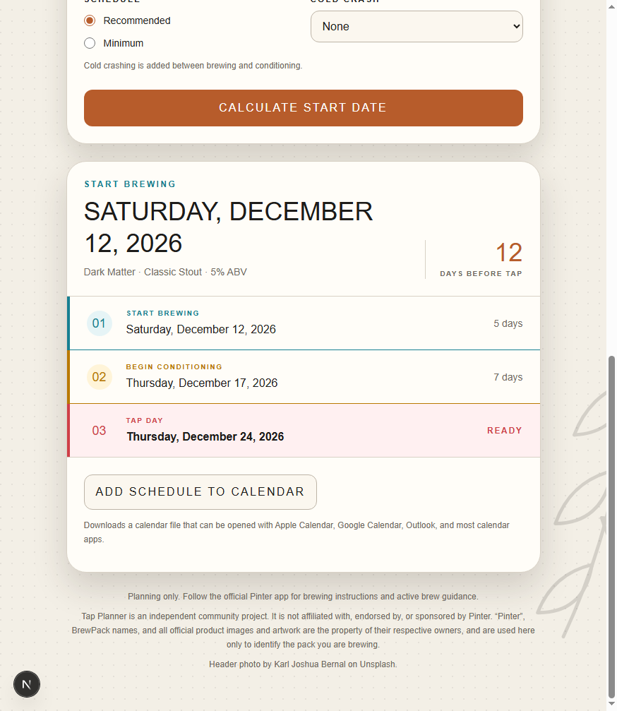
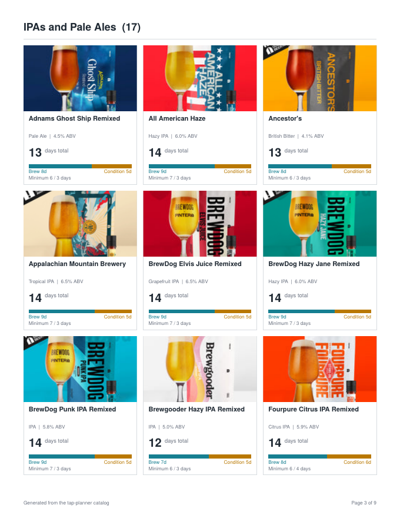
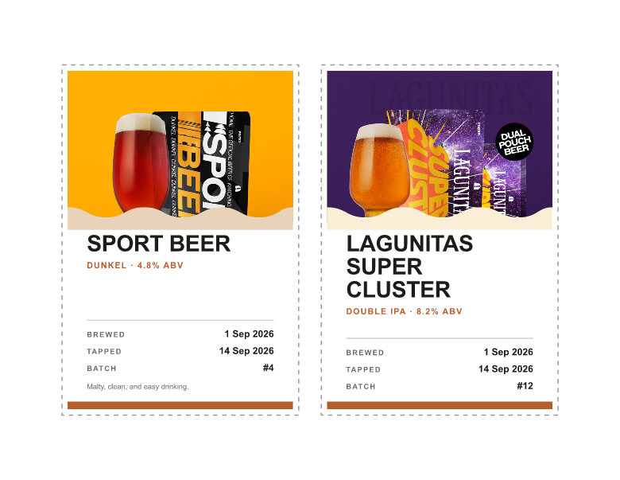
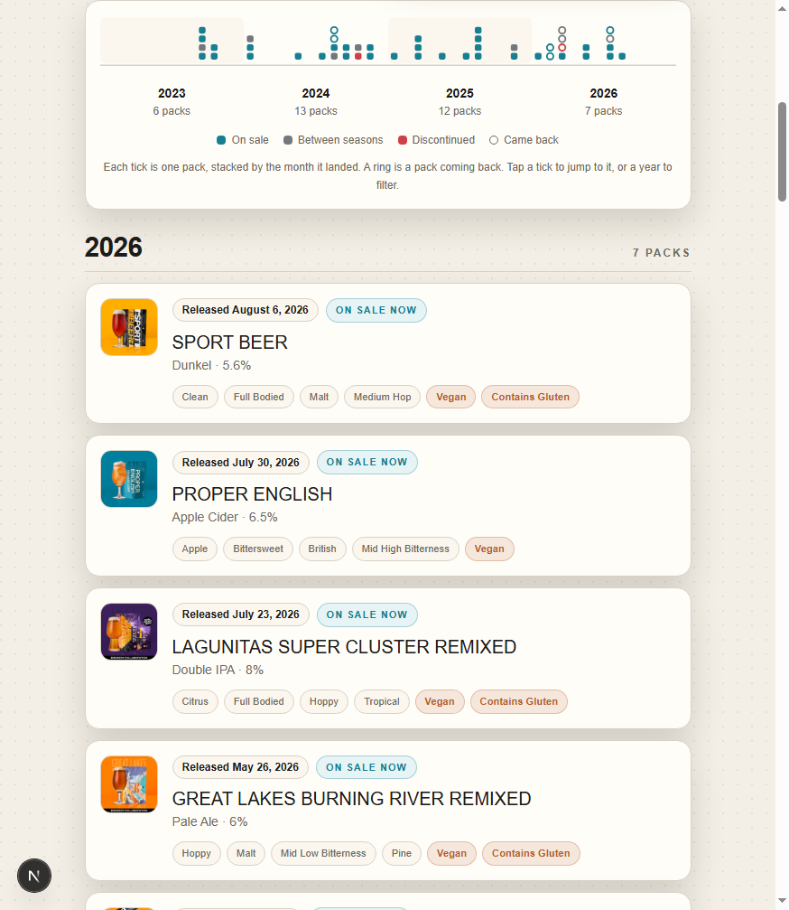
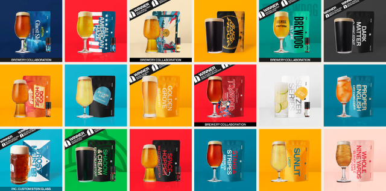

<div align="center">

# 🍺 Tap Planner

**Choose your tap date. Tap Planner works backward and tells you when to begin.**

[](https://tap-planner.vercel.app/)
[](https://tap-planner.vercel.app/schedule/pdf)

[](https://nextjs.org/)
[](https://www.typescriptlang.org/)
[](https://vercel.com/)



</div>

---

Pinter tells you how long a BrewPack takes. It doesn't tell you when to start
if you want it ready for a particular day. Tap Planner does that arithmetic
(fermentation, an optional cold crash, and conditioning, counted backward from
your tap date) and then gets out of the way.

No accounts, no database, nothing stored. Every calculation happens in your
browser.

## Six ways to use it

| | Page | Use it when |
|---|---|---|
| 🍺 | **[BrewPack planner](https://tap-planner.vercel.app/)** at `/` | You're brewing an official pack and want its recommended or minimum timing |
| 🧪 | **[Custom planner](https://tap-planner.vercel.app/custom)** at `/custom` | You're brewing your own recipe, or overriding a pack's timing |
| 🔄 | **[Rotation planner](https://tap-planner.vercel.app/rotation)** at `/rotation` | You run several Pinters and want them staggered so you never run dry |
| 📅 | **[Release timeline](https://tap-planner.vercel.app/releases)** at `/releases` | You want to know when a pack appeared, or when a seasonal might return |
| 🏷️ | **[Brew labels](https://tap-planner.vercel.app/labels)** at `/labels` | You want to know what's actually in the fridge |
| 📖 | **[Brewing schedule](https://tap-planner.vercel.app/schedule)** at `/schedule` | You want every pack's timing at a glance, or a PDF to hand to someone |

## Brewing schedule

<div align="center">

</div>

A catalogue of every BrewPack: its photo, style, ABV, recommended brewing and
conditioning days, total days, and Pinter's minimums. It is meant for people who
don't use the app at all.

| Get it as | Link |
|---|---|
| **PDF**, nine pages, US Letter | [tap-planner.vercel.app/schedule/pdf](https://tap-planner.vercel.app/schedule/pdf) |
| **CSV**, for a spreadsheet | [tap-planner.vercel.app/schedule/csv](https://tap-planner.vercel.app/schedule/csv) |
| **Web page**, with search, filters and sorting | [tap-planner.vercel.app/schedule](https://tap-planner.vercel.app/schedule) |

The PDF is built like a small book. Page 1 is a cover with a clickable contents
list, page 2 is a one-page quick reference of every pack, and the rest are
sections by beer family: IPAs and Pale Ales, Lagers and Pilsners, Stouts and
Dark Beers, Wheat, Belgian and Sour, and Ciders and Seltzers. Discontinued and
unavailable packs get a section of their own at the end. Your PDF viewer's
bookmark panel lists the sections, every page is numbered, and the text is
searchable.

The links never change. When the catalog updates, the same addresses serve the
new file, so share them freely.

The schedule catalogue was Jack Paul's idea, and it grew from the original
schedule document he created.

## How the schedule works

Pick a pack, pick the day you want to pour, and Tap Planner counts backward:

```
(brewing or fermentation) + cold crash + conditioning = total lead time
```

For a 24 December tap date with 5 brewing days and 7 conditioning days, it
tells you to start on 12 December, and shows every stage in between.

You can switch between **recommended** and **minimum** timing, add 1 to 3 days of
cold crash, and it will tell you plainly when a date isn't achievable rather
than quietly producing a schedule that starts in the past.

**Add schedule to calendar** downloads a standard `.ics` file with each stage
as an all-day event spanning its real date range. It is generated in your
browser. Tap Planner never asks for calendar access and adds nothing
automatically.

## Brew labels

<div align="center">

</div>

Print a business-card-size label for each brew: name, style, ABV, brew and tap
dates, batch number, tasting notes.

- **US Letter** (default): as many labels of the chosen size as fit, with cut
  guides, and they can be different beers. Printed landscape. The page preview
  is drawn to scale.
- **One label**: a single label at the chosen size.
- **Business cards**: ten per perforated 2×3.5 sheet.

Save the card instead as a **PNG** at 300dpi or an **SVG**, which stays sharp at
any size. Both are built in the browser from the card on screen.

<details>
<summary><strong>Which paper survives a fridge?</strong></summary>

Any paper works, but a fridge is cold, humid, and prone to condensation.

| Paper | Verdict |
|---|---|
| Waterproof synthetic (vinyl, polypropylene) | **Best**: immune to condensation |
| Matte photo paper, RC-coated | **Great**: resists moisture, still writable |
| Cardstock, 65 to 110lb | **Good**: stiff and cheap, softens if it gets damp |
| Plain printer paper | **Works**: goes wrinkly in a few days |

Two things matter more than the paper:

- **Your ink.** Laser toner is fused plastic and waterproof on anything,
  including copy paper. Consumer inkjet dye ink runs the moment condensation
  touches it.
- **Apply labels at room temperature, then chill.** Standard adhesive barely
  grabs an already-cold surface. This is the most common reason fridge labels
  fall off.

A strip of clear packing tape over the front laminates any card for about a cent.

</details>

## Release timeline

<div align="center">

</div>

Pinter has never published release dates, so these are **estimates** worked out
from timestamps on the online store. Treat it as trivia and a rough guide to
when seasonals reappear, not a source of truth. Anything marked *Approx.* is
month-only on purpose, because a pack that goes away and comes back has its
store date overwritten by the return.

The density strip plots one mark per release event by month, so launch waves
and quiet stretches are visible as shape. A filled tick is a launch, an open
ring is a pack coming back; hover either and the pair links up.

## Artwork

Every pack in the catalog is shown with Pinter's own product photography:

<div align="center">

</div>

Where a photo isn't available (a custom recipe, or a pack that leaves the
store before it is ever captured), Tap Planner generates a label design from
the beer style instead, so a card never comes out blank. Colour comes from the
style and the motif from its family: hops for the IPAs, grain for the lagers,
roasted beans for the stouts.

Images are stored locally and served from this app. Nothing is hotlinked, and
nothing is fetched from Pinter at runtime.

## Staying current

Scheduled workflows check Pinter's public BrewPack listing, validate the
catalog, rebuild the release timeline, regenerate the brewing schedule PDF and
CSV, run lint and a production build, and open a pull request.

> **Nothing is published silently.** Catalog, image and schedule changes are
> reviewed and merged before they reach the live app, and the schedule links
> above then serve the new files.

## Credits

- **Jack Paul:** the idea for printing brew labels and for the brewing schedule
  catalogue, and the author of the original schedule document it grew from.
- **App icon** (tap tower, beer mug, and calendar): designed by
  [@mshawotr-mikeintyler](https://github.com/mshawotr-mikeintyler), contributed
  in [#29](https://github.com/WestbergLabs/tap-planner/issues/29). Thank you! 🍻

## Important notice

Tap Planner is an independent community project. It is **not** affiliated with,
endorsed by, or sponsored by Pinter. "Pinter", BrewPack names, and all official
product images and artwork are the property of their respective owners, and are
used here only to identify the pack you are brewing.

Use Tap Planner for planning. Continue using the official Pinter app for
brewing instructions, safety guidance, product support, and decisions during
your brew.

---

<div align="center">

**[Developer documentation](docs/DEVELOPMENT.md)**: setup, project structure,
the BrewPack pipeline, the image policy, and deployment.

Built for better brew planning. 🍻

</div>
